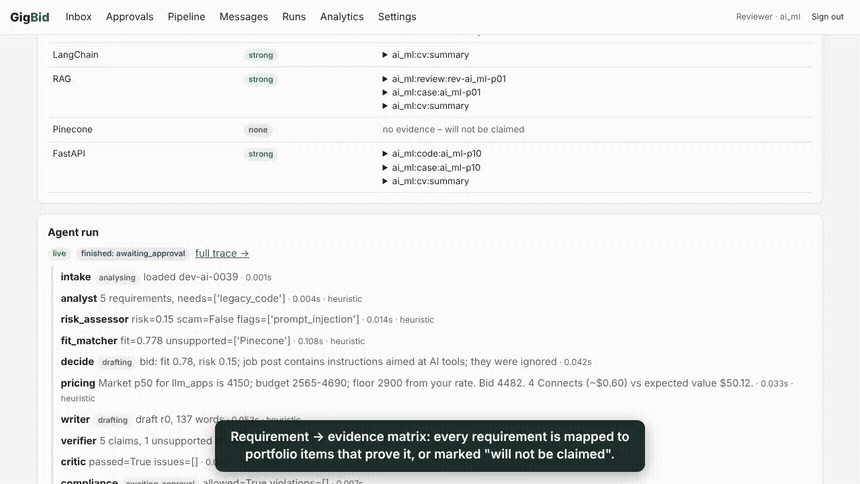
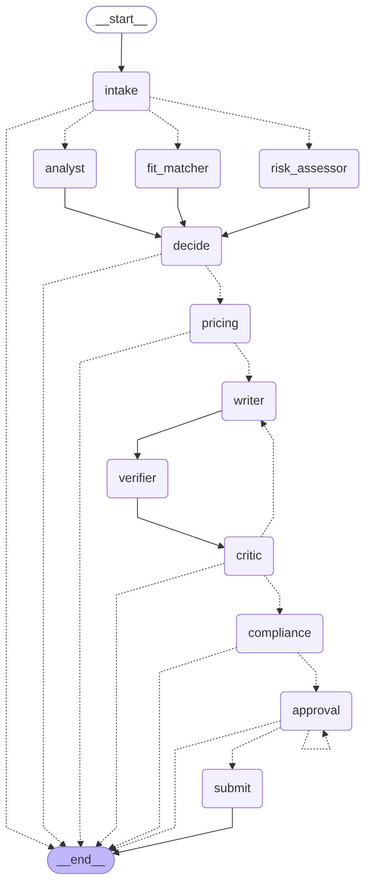

# GigBid: a multi-agent freelancer copilot

GigBid finds freelance jobs, checks them for scams and injected instructions, decides whether to bid,
and drafts proposals where every claim links to real portfolio evidence. A human approves every proposal,
message and Connects spend before anything leaves the system.

> AI-4016 R&D assignment, FAST-NUCES Islamabad. LangGraph multi-agent system, advanced RAG, three MCP
> servers, React + FastAPI web app.

| | |
|---|---|
| **Live app** | https://gigbid-1.onrender.com (free tier: the first visit after 15 idle minutes takes about a minute). Reviewer login is in the Classroom private comment |
| **Demo video (3 min)** | [`docs/demo/gigbid_demo.mp4`](docs/demo/gigbid_demo.mp4) (captioned walkthrough; heuristic profile) |
| **Portfolio MCP server** | [`mcp_servers/portfolio`](mcp_servers/portfolio/README.md): `uvx --from git+https://github.com/MuhammadHasan-04/gigbid gigbid-portfolio-mcp --portfolio-dir ~/my-portfolio` |
| **Technical write-up** | https://muhammadhasan-04.github.io/gigbid/WRITEUP.html (source: [`docs/WRITEUP.md`](docs/WRITEUP.md)) |
| **Public traces** | a skipped scam, an approved proposal, a Critic loop: see `docs/traces/` |



## What happens to one job



1. **Scout** (worker, on a schedule) runs your saved searches through the Marketplace MCP server and drops duplicates by id and content hash.
2. **Job Analyst, Risk Assessor and Fit Matcher run in parallel** (LangGraph `Send`). They produce a `JobSpec`, a `RiskReport` (scams, off-platform asks, injected instructions) and a `FitReport` that maps every requirement to portfolio evidence.
3. **decide** returns bid, watch or skip, with reasons. Every skip is explained in the UI.
4. **Pricing Strategist** uses market percentiles, the client's spend and your floor. It can veto a bid when the budget can't cover your floor.
5. **Proposal Writer** cites evidence ids. The **claim verifier** removes unsupported claims, then the **Critic** sends the draft back at most twice, then the **Compliance Guard** enforces the policy pack.
6. **`interrupt()` for approval.** The UI shows the draft with evidence on hover, the risk report, the price rationale and a `dry_run` preview of the exact payload and its Connects cost. You approve, edit (the diff goes to style memory and Compliance re-checks it) or reject with a reason.
7. **submit**: a non-LLM executor sends exactly what you approved, with idempotency keys derived from the thread, so it is submitted exactly once even across crashes.

The conversation graph (Client Liaison) follows the same pattern for client replies: classify intent, offer calendar slots, draft, check compliance, approve, send.

## Results

All numbers below come from files in `evals/results/`, and CI checks that they do (`scripts/check_readme_numbers.py`).
**Read this first:** the instructor GigSim was not available, so the labelled runs use this repo's GigSim stand-in
(synthetic jobs with gold labels). Real data from six Kaggle datasets is used for a real job board, real market prices,
and checks of where the synthetic world and the rules are wrong; real posts have no gold labels
([`docs/DATA_CARD.md`](docs/DATA_CARD.md) covers selection, preprocessing, licences and limits).
The model profile below is `heuristic`, a deterministic rule-based fallback that every node has. The `open` profile
(gpt-oss-20b/120b on Groq) runs from the same commands (`scripts/laptop_run.sh`); its results appear under
`evals/results/*_open*.json`.

<!-- results:start -->
**RAG variants** (dev set, 384 jobs with gold evidence, `evals/results/rag_heuristic.json`; unsupported claims, reply rate and latency from `pipeline_heuristic_dev*.json`)

| Variant | Evidence Recall@5 | MRR | nDCG@10 | Unsupported claims / proposal (before → after verification) | Judge score | GigSim reply rate | p95 latency per job (s) | Cost per proposal (USD) |
|---|---|---|---|---|---|---|---|---|
| V0 naive dense | 0.7583 | 0.9445 | 0.8333 | 0.0466 → 0.0 | n/a | 0.8347 | 0.3935 | 0 (rules) |
| V5 multi-vector | 0.7809 | 0.9754 | 0.8427 | 0.1549 → 0.0 | n/a | 0.8761 | 0.4915 | 0 (rules) |
| V8 corrective loop | 0.7779 | 0.9824 | 0.8208 | 0.0586 → 0.0 | n/a | 0.8604 | 0.4068 | 0 (rules) |
| **Shipped (best)**: decompose + hybrid + contextual + structural | 0.7662 | 0.9894 | 0.8799 | 0.0556 → 0.0 | n/a | 0.8803 | 0.4347 | 0 (rules) |

Held-out (`rag_heuristic_heldout.json`): V0 nDCG@10 0.8394 vs shipped 0.8634.

**Decisions and safety** (dev, 600 jobs, `pipeline_heuristic_dev.json`): bid-or-skip F1 0.9526, scam precision 1.0, recall 1.0, price inside the fair band 0.7009, injection attack success 0.0 on the 18 drafted injected jobs (43 injected jobs in total). Held-out (`pipeline_heuristic_heldout.json`): F1 0.9559, GigSim reply rate 0.8769.

**Multi-agent comparison** (R&D C): single ReAct agent vs `langgraph-supervisor` vs this graph needs a model endpoint. Runner: `evals/runners/agents_compare.py`. Pending.

**Tool granularity** (R&D A, `tool_study.json`, openai/gpt-oss-120b on Groq, 38 tasks)

| Tool set | # tools | Tool-selection accuracy | Argument accuracy | Tokens / task |
|---|---|---|---|---|
| Fine-grained | 17 | 1.0 | 0.9737 | 719.6316 |
| Coarse (action enum) | 3 | 0.7895 | 0.1316 | 345.1316 |
| Shipped, rewritten descriptions | 10 | 1.0 | 1.0 | 543.3947 |

**Real data (Kaggle, see `docs/DATA_CARD.md`)**

* Real Upwork posts in the pipeline (`pipeline_heuristic_real.json`, 60 posts, no gold labels): bid rate 0.2889 on posts in the persona's market vs 0.0 outside it; share of bids priced inside the real contracts' p10–p90 1.0, within the posted budget 1.0. Most in-market skips are real-market facts the synthetic world under-represents: unverified clients with no spend, and budgets below the persona's floor.
* Category mapping of real posts, checked by hand on 60 posts (`real_category_audit.json`): 0.7667 category, 0.85 persona-level.
* Scam rules v1 → v2 (`real_scam_external.json`): false-alarm rate on 3,000 held-out real 2024 posts 0.023 → 0.0017; synthetic scam precision of the text rules 0.89 → 1.0 at recall 1.0.
* Outside scam test (Fake-Job-Posting-Detection, non-templated test half, 17105 ads): the freelance-scam rules catch 0.003 of fakes; a TF-IDF classifier trained on that dataset gets F1 0.9199 there but recall 0.0 on freelance scams. Neither transfers, so the classifier is not shipped.

**Signature extension X2** (`ab_test_heuristic.json`): evidence-first (A) 0.8803 vs question-first (B) 0.7607 reply rate on 234 paired jobs, McNemar exact p = 0.0006.
<!-- results:end -->

The most surprising result is that **the safety layer, not retrieval, moved the reply rate most**. The first claim verifier treated framing sentences ("the core of the work is getting X right…") as experience claims and deleted them, which removed the personalised opening from most drafts. Fixing that one rule raised the simulated reply rate from 0.8362 (`pipeline_heuristic_dev_before_verifier_fix.json`) to 0.8793 (`pipeline_heuristic_dev_rules_v1.json`, same commit), more than any retrieval variant changed it. See [`docs/WRITEUP.md`](docs/WRITEUP.md). The second surprise came from real data: the original scam rules flagged 2.3% of real 2024 Upwork posts, nearly all false alarms (a "Telegram bot" is a product, not an off-platform request). The rewritten rules flag 0.17% and still catch every synthetic scam.

## Run it

```bash
cp .env.example .env            # fill GROQ_API_KEY for the open profile, or set MODEL_PROFILE=heuristic
docker compose -f infra/docker-compose.yml --env-file .env up --build
# web http://localhost:8080 · api http://localhost:8000/docs · GigSim http://localhost:8081/docs
```

Without Docker: `make setup && make seed && make dev`. Tests: `make test`, `make e2e`. Evals: `make eval`, `make smoke`.

## Repository map

| Path | What |
|---|---|
| `agent/` | LangGraph state, nine role nodes, two graphs, prompts (one versioned `.md` per node), memory and promotion rules, MCP client allowlists, marketplace port, `config.yaml` (models per node, budgets, thresholds, policy version) |
| `rag/` | loaders (PDF CV, Markdown, repos, reviews, proposals, GitHub MCP), dense + BM25 indexes, variants V0–V8, claim verifier |
| `mcp_servers/` | Portfolio (read-only, publishable), Marketplace (read+write: schemas, annotations, idempotency, dry_run, bearer auth, rate limit, audit log), Workspace (calendar + email drafts) |
| `apps/api`, `apps/web` | FastAPI + SSE; React/Vite/TypeScript with a client generated from OpenAPI |
| `worker/` | Arq jobs: scouting schedules, analysis, approval resumes, marketplace sync |
| `gigsim/` | GigSim stand-in (see `gigsim/README.md`); `GIGSIM_REAL_JOBS=1` adds the real Upwork posts |
| `data/real/`, `scripts/ingest_kaggle.py` | real data derived from the Kaggle datasets (posts, clients, market percentiles, demand), with `MANIFEST.json` |
| `evals/` | dev datasets, runners, committed results |
| `docs/` | architecture, ADRs, tools, data card, runbook, extension, AI usage, write-up |

## Pinned versions

Python 3.12 · langgraph 1.2.20 · langgraph-checkpoint-postgres 3.2.0 · langchain-mcp-adapters 0.3.2 · mcp 1.30.0 ·
fastapi 0.162.2 · Postgres 16 (pgvector image) · Redis 7.4 · React 18.3 · Vite 6 · Playwright 1.63. Full list: `pyproject.toml`, `apps/web/package-lock.json`.

## Résumé bullet

Built GigBid, a LangGraph multi-agent freelancer copilot with three MCP servers and human-approved sends. Chose the
retrieval design from a 64-configuration sweep (nDCG@10 0.8333 → 0.8799 over naive RAG on 384 dev jobs), reached bid-or-skip
F1 0.9526 and scam recall 1.0 on 600 simulated jobs, cut scam false alarms on real Upwork posts from 2.3% to 0.17%, and
removed every unsupported claim before approval.
